# TopNews

一个参考「今日头条」信息流布局的 Android 新闻资讯示例 App，使用 Kotlin + Jetpack Compose 实现，并内置一个可离线游玩的赛车小游戏。

- **包名**：`com.zq.topnews`
- **最低版本**：Android 7.0（API 24），编译/目标版本 API 35
- **UI**：Jetpack Compose + Material 3，接近今日头条的首页信息流、频道切换、文章详情、视频双列宫格、消息列表和个人中心

## 功能

| 模块 | 内容 |
| --- | --- |
| 首页 | 红色品牌搜索栏、推荐/热点/科技/体育/财经/娱乐频道切换、头条大图卡片 + 图文列表、评论数与发布时间；实时拉取**网易新闻公开接口**（无需密钥/登录） |
| 文章详情 | 沉浸式阅读页、分享（复制链接 / 系统分享）/收藏操作、正文分段排版、底部评论输入栏；正文按需从公开接口加载 |
| 视频 | 实时拉取**哔哩哔哩公开热门接口**（无需密钥/登录），双列宫格展示封面、时长、UP 主与播放量；支持刷新按钮、失败重试，点击卡片跳转 B 站 |
| 消息 | 点赞 / 评论 / 粉丝 / @我 / 系统通知 / 私信 六类消息入口 |
| 我的 | 头像与登录入口、动态/关注/粉丝统计、收藏/历史/商城/钱包快捷入口、设置与帮助菜单；登录后展示账号与「退出登录」 |
| 赛车小游戏 | 「我的」页入口，可离线游玩；3 车道无尽模式，左右拖动或点击变道躲避车流，得分随行驶距离增长、车速逐渐加快；最高分保存在本机，支持暂停、继续与重新开始 |
| 登录 / 注册 | 登录、注册表单与输入校验，本地 mock 账号（注册后自动登录、会话可恢复、支持退出）；演示账号 `demo` / `123456` |

返回键逻辑：文章详情页按返回回到信息流，登录/注册页按返回回到「我的」；赛车游戏中按返回先暂停，再按返回退出游戏。

## 截图

| 首页 | 文章详情 | 视频 |
| --- | --- | --- |
|  |  | 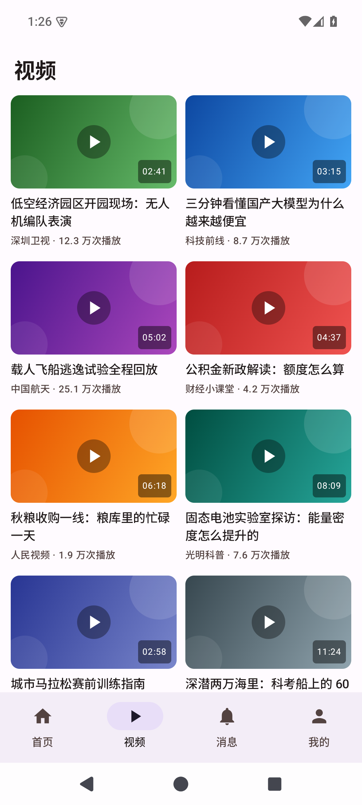 |

| 频道切换 | 消息 | 我的 |
| --- | --- | --- |
| 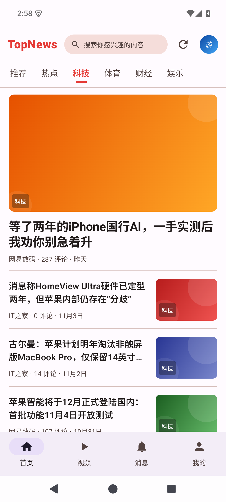 | 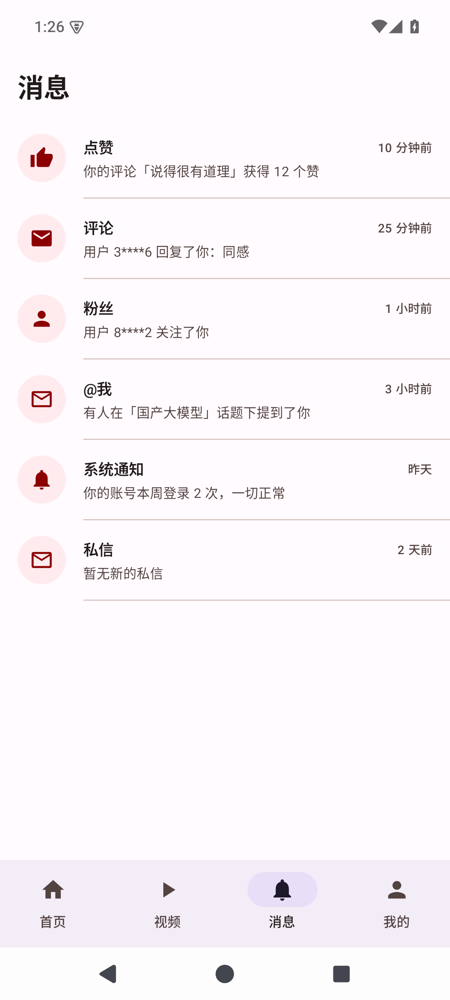 | 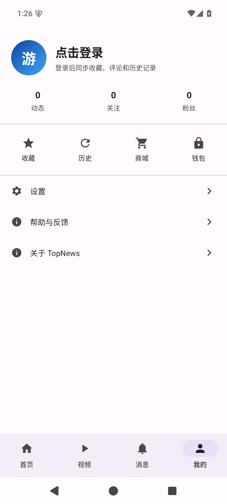 |

| 登录 | 注册 | 登录后的「我的」 |
| --- | --- | --- |
| 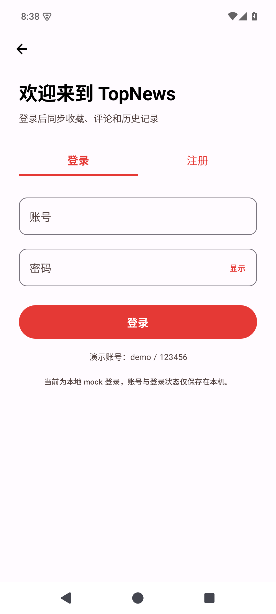 | 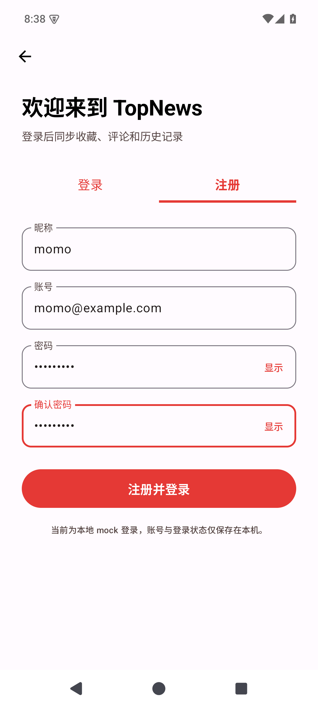 | 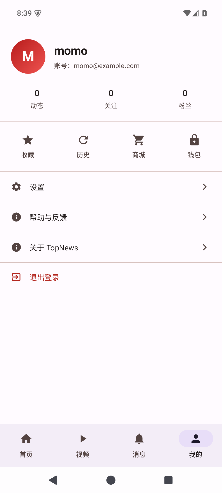 |

### 赛车小游戏

| 「我的」入口 | 开始游戏 | 游戏中 |
| --- | --- | --- |
| 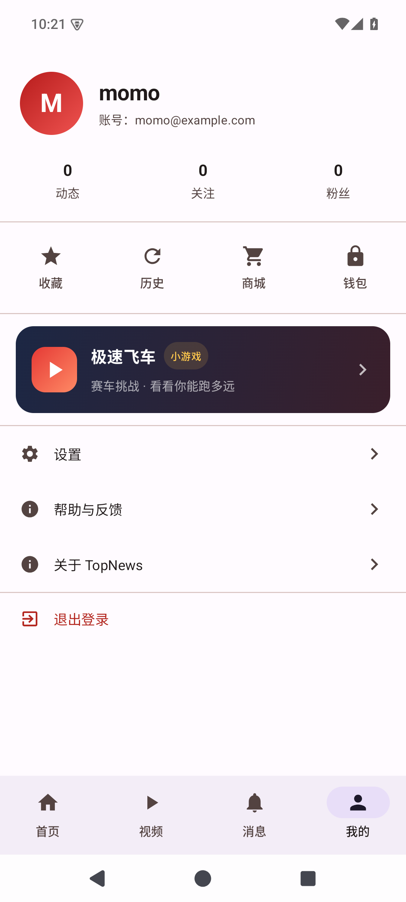 | 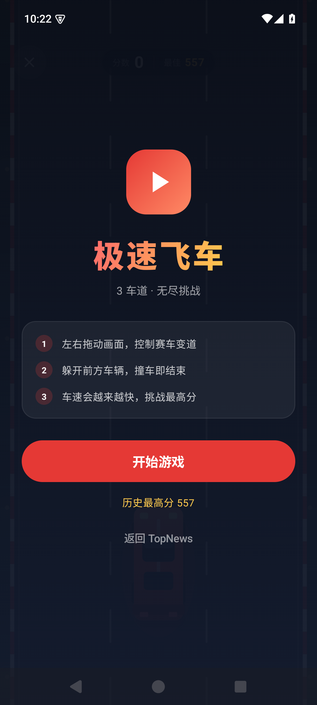 | 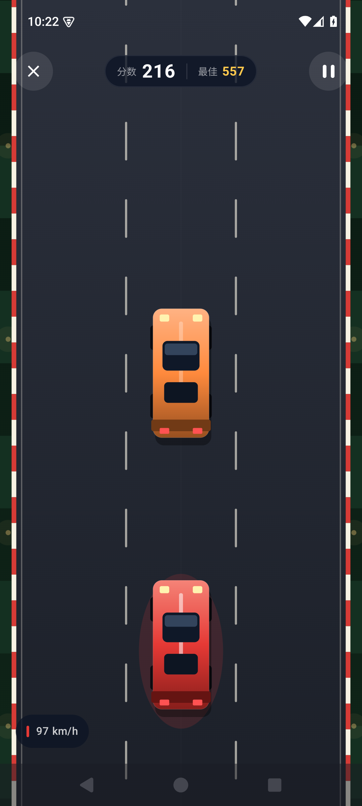 |

| 暂停 | 撞车结束 |
| --- | --- |
| 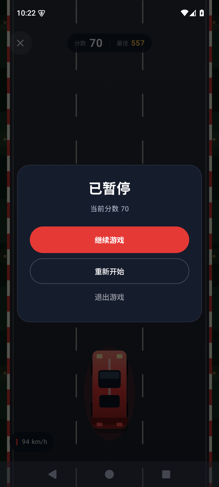 | 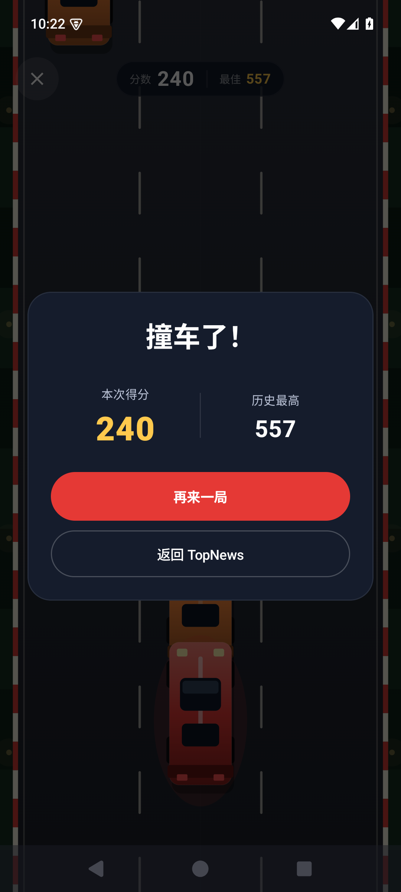 |

## 构建

需要 JDK 17 和 Android SDK（platform 35、build-tools 35.0.0）。

```bash
export JAVA_HOME=/path/to/jdk-17
export ANDROID_HOME=/path/to/android-sdk

./gradlew assembleDebug          # 产物：app/build/outputs/apk/debug/app-debug.apk
./gradlew testDebugUnitTest      # 接口解析与赛车游戏规则单元测试
adb install -r app/build/outputs/apk/debug/app-debug.apk
adb shell am start -n com.zq.topnews/.MainActivity
```

## 数据来源

- **新闻频道**：网易新闻公开接口，无需密钥或登录。列表为 `https://3g.163.com/touch/reconstruct/article/list/<channel>/0-20.html`（JSONP），正文为 `https://3g.163.com/touch/article/<docid>/full.html`。频道对应关系：推荐→头条、热点→国内、科技→数码、体育→体育、财经→财经、娱乐→娱乐；结果在内存中缓存，切换标签页不会重复请求，标题栏右上角可手动刷新。
- **视频频道**：`https://api.bilibili.com/x/web-interface/popular`，B 站公开接口，无需 App Key 或登录；封面通过 Coil 加载，请求会携带 B 站要求的 Referer。接口结果在内存中缓存，切换标签页不会重复请求。
- **消息 / 个人中心**：内置示例数据（`data/` 包），图片用渐变占位（`ui/components/Placeholder.kt`）。
- **赛车小游戏**：纯 Compose Canvas 绘制与本地模拟，不依赖网络或图片资源；最高分保存在本机 SharedPreferences。
- 新闻与视频页需要网络；加载失败会展示错误页和「重试」按钮，文章正文加载失败时也可单独重试。消息、个人中心与赛车游戏离线可用。

> 本项目仅用于学习 Compose 与公开接口调用，视频内容版权归哔哩哔哩及原作者所有。

测试注释：这一行由自动化代理添加，用于验证 README 修改流程。
